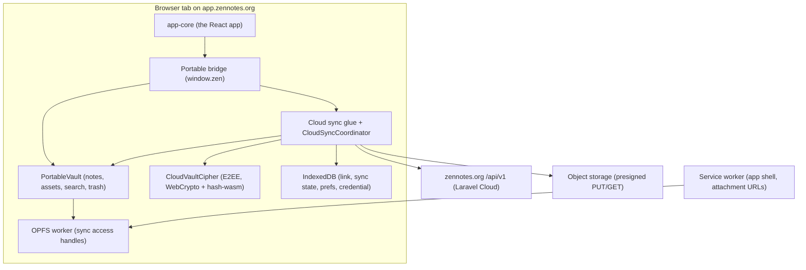

# ZenNotes Cloud in the browser

Open your Cloud vault in a browser tab: the same app, Vim mode included, with
your notes kept in the browser and synced like a phone.

> **Status (November 9, 2026).** Design document, nothing built. Written after
> Adib picked "open your Cloud vault in a browser" as the Cloud feature that
> drives signups. Where it disagrees with Phase 5 of the
> [ecosystem boundaries plan](../specs/ecosystem-boundaries-and-repository-plan.md)
> (September 15, before end-to-end encryption launched), this document wins, and
> [Why not the September plan](#why-not-the-september-plan) says why. Adib
> approved the build plan the same day and settled the open questions; see
> [Decisions](#decisions-november-9).

## Why

Cloud users must install an app before they can see their notes. Some can't
(a work laptop, a library computer, a Chromebook), some won't yet (someone
deciding whether to pay), and some are away from their own machine. Every one of
them is a lost signup or a lost session today.

A browser entry point does two jobs:

- **Reach.** "Your notes on any computer" is a reason to pay for Cloud that the
  apps alone don't give.
- **Trial.** A homepage button that opens a working ZenNotes in the tab, with no
  account and no download, and turns into a Cloud vault with one sign-up.

## The shape in one paragraph

A static web app at `app.zennotes.org` runs the same React app as desktop and the
phones (`packages/app-core`). Its vault lives in the browser's Origin Private File
System (OPFS), and it syncs with ZenNotes Cloud through the same TypeScript sync
engine the phones use (`CloudSyncCoordinator` behind `PortableCloudSyncFileSystem`),
over the existing v1 API. It signs in as a device, like an app, and can be
revoked from Connected apps. An encrypted vault decrypts in the tab, the server
still sees only ciphertext. Nothing new runs on a server: the API is the one the
apps already use, plus small changes for a browser origin.

## Decisions at a glance

| Question | Decision |
| --- | --- |
| Backend | The existing Cloud API. Not znserver, not new Laravel editing endpoints. |
| Engine | The shared sync engine, unchanged, on an OPFS vault: the browser is a fourth sync host. |
| Vault code | Lift the phones' vault layer into one package first, so the browser does not become copy number three. |
| Origin | `app.zennotes.org`, static files, a different origin from `zennotes.org`. |
| Sign-in | The apps' PKCE flow with an https callback; the browser registers as a device with platform `web`. |
| Tabs | One tab owns a vault (edits and syncs it), through Web Locks. Other tabs offer "Use here". |
| Big vaults | Notes and other text download first; large attachments download when opened. |
| Encryption | Supported. Argon2id and AES-GCM run in the tab; the security page says plainly what that trusts. |
| Shared computers | A sign-in option that keeps keys in memory and wipes the local copy on sign-out. |
| Trial | A local-only vault at `app.zennotes.org/try`, seeded with the demo tour, that can become a Cloud vault. |

## Why not the alternatives

### Not znserver

znserver is single-tenant: one auth token, one plaintext folder on its own disk,
no Cloud code. Hosting it for Cloud users means a container per user, a
plaintext copy of every vault on our disks (which breaks end-to-end encryption
outright), and a Go port of the TypeScript sync engine to keep those copies in
step with Cloud. We reuse its web UI (`apps/web`), not its backend.

### Why not the September plan

Phase 5 of the boundaries plan proposed an online editor served from the Laravel
origin: session cookies and CSRF, read-only first, then new Laravel endpoints for
browser saves, with offline sync "a later scope". Two things changed or were
not weighed then.

1. **End-to-end encryption launched (October 13).** The server cannot read an
   encrypted vault, so a browser must decrypt in the tab, which means speaking the
   item and revision protocol with the vault cipher. That is the sync engine. A
   second, online-only write path in PHP (P5.4) would duplicate the coordinator's
   conflict, rename and idempotency rules and would still not work for encrypted
   vaults.
2. **The engine already gives what P5.5 asked for.** Stale revisions, offline
   saves, reloads and expired logins keep recoverable edits because the engine is
   offline-first. Building online editing first and offline later builds the hard
   part twice.

The plan's worry about putting a long-lived token in browser storage is real and
is answered under [Signing in](#signing-in-as-a-device) and
[Trust](#trust-what-the-website-should-say). The plan's reason for the Laravel
origin (avoiding cross-origin session setup) disappears once the browser holds a
device token like every other client, and a separate origin is the stronger
boundary anyway: see [Hosting](#hosting-at-appzennotesorg).

### Not a real folder on disk (yet)

The File System Access API can open a folder on the user's disk, which would make
the browser a local ZenNotes. It exists only in Chromium on desktop, and a Cloud
vault in a browser does not need it. It is a later option for the local-only mode.

## Architecture



Three layers, each with one owner:

- **`packages/app-core`**: unchanged. It already hides what a host does not
  support through `ZenCapabilities` (the web build turns Cloud off with
  `supportsCloudSync: false`; this build turns it on).
- **`packages/portable-vault`** (new): the vault layer and Cloud glue the phones
  share today as copies, plus the bridge factory. It talks to storage only
  through host interfaces.
- **Hosts**: iPhone (Capacitor Filesystem, iCloud), Android (Capacitor
  Filesystem, SAF), and the browser (OPFS, IndexedDB, Web Locks). The browser host
  is a second bootstrap in `apps/web` (`src/cloud/`), built as its own artifact
  next to the self-hosted one, as the boundaries plan asks: "the browser builds
  share source but select their adapter/bootstrap explicitly".

## Step zero: one portable vault package

### What is copied today

Both phone repos (`~/Developer/apps/zennotesiphone`, `~/Developer/apps/zennotesandroid`)
carry about 16 to 17 thousand lines in `src/bridge/`. Of the non-test files they
share, 9 are identical and 22 have drifted. The biggest:

| File | Lines (iPhone) | Lines that differ |
| --- | --- | --- |
| `vault-fs.ts` (`MobileVault`) | 1896 | 179 |
| `mobile-bridge.ts` | 1380 | 324 |
| `native-fs.ts` | 513 | 617 |
| `mobile-cloud-sync.ts` | 491 | 215 |
| `mobile-cloud-auth.ts` | 478 | 214 |
| `mobile-cloud-encryption.ts` | 131 | 267 |
| `mobile-direct-upload.ts` | 603 | 175 |
| `cloud-sync-client.ts` | 340 | 141 |

The drift is not cosmetic. For example, `deleteAsset` on iPhone writes the
restore record before moving the file and rolls back on failure. Android still
moves first, so a failure between the two steps leaves an asset in the
deleted-assets store with no record, invisible to the Trash view.

Going the other way, Android has fixes iPhone lacks (template folder skipped
during the search walk, demo-tour cleanup limited to files, and `cloud-layout.ts`,
which reconciles the folder layout when joining a Cloud vault). Every fix today
has to be ported by hand, twice, and a browser host would make it three times.

### What moves into the package

Everything that is TypeScript over a file interface:

- `vault-fs.ts` (as `PortableVault`), `vault-core.ts` (which holds the sixth
  `stripCodeContent` copy; the package imports shared-domain's instead where the
  behavior matches), `welcome-note.ts`, `database-open.ts`, `link-metadata.ts`,
  `imported-assets.ts`, `events.ts`, `uuid.ts`, `base64.ts`, `tikz.ts`;
- the portable half of `mobile-bridge.ts`, as `createPortableBridge(host)`;
- the Cloud glue: `mobile-cloud-sync.ts`, `cloud-sync-repository.ts`,
  `cloud-sync-staging.ts`, `cloud-sync-client.ts`, `cloud-sync-refresh.ts`,
  `cloud-sync-work.ts`, `mobile-cloud-auth.ts`, `mobile-cloud-encryption.ts`,
  `mobile-publish-assets.ts`;
- the remote-workspace client (`remote-*.ts`), which the phones share and the
  browser does not use;
- Android's `cloud-layout.ts` and `fs-errors.ts`, which iPhone lacks;
- TikZJax's assets (about 12 MB in each phone's `public/tikzjax/`), shipped as
  package files that each host copies to where `tikz.ts` loads them.

What stays native: `native-fs.ts` behind the new interface, `icloud.ts`,
`folder-picker.ts`, widgets, keyboard and system-bar code, background sync, and
the native half of direct uploads (the Swift and Java plugins).

### The host interfaces

`native-fs.ts` already has the right shape. Its basic methods (`readText`,
`readBase64`, `writeText`, `writeBase64`, `statOrNull`, `readdir`, `mkdir`,
`rename`, `copy`, `deleteFile`, `rmdir`) are path-based and an OPFS
implementation can satisfy them. The rest assumes a native path, so it becomes
optional or moves behind small interfaces:

- `VaultFileSystem`: the basic methods above.
- `SyncFastPath` (optional): `readForSync`, `copyForSync`, `download`,
  `readHeader`, `decryptFile`, `sealForUpload`. Phones implement it with their
  native plugins; the browser leaves it out and the shared code takes the
  JavaScript path that `PortableCloudSyncRepository` already has.
- `AssetUrls`: `fileSrc(path)` is `convertFileSrc` on the phones and a
  service-worker URL in the browser (see [attachments](#notes-first-attachments-on-open)).
- `HostStorage`: JSON by key for the Cloud link, sync state and scan cache. Phones
  write files in `Directory.Data` today; the browser uses IndexedDB.
- `SecretStorage`: the credential, the pending sign-in and the E2EE account key.
  Phones use Keychain/Keystore secure storage; the browser has its own rules
  (below).
- `HttpTransport`: five of the lifted files call `CapacitorHttp` directly
  (`cloud-sync-client.ts`, `mobile-cloud-auth.ts`, `link-metadata.ts`,
  `remote-client.ts`, `mobile-bridge.ts`), with their own timeout and stall
  handling. Phones keep `CapacitorHttp`; the browser uses `fetch`.
- `AppLifecycle`: the sign-in callback (`appUrlOpen`, `getLaunchUrl` on the
  phones, a route in the browser), foreground and background, and the
  leave/return hooks that run the final sync.
- `HostShell`: app version, device name, platform, open-external, share,
  clipboard, and saving a downloaded backup (`downloadFile` plus the share sheet on
  the phones, a browser download in the tab).

The interfaces carry semantics, not just signatures, and the lifted code depends
on them: `readdirStrict` fails where `readdir` is lenient (a lenient failure read
as an empty vault would plan deleting the whole vault), `statVerified` returning
null means verified absence, `writeGeneration` invalidates the walk cache, and
`rootPath` keys the Cloud link. A host adapter that turns an error into `[]` or
`null` is a data-loss bug, so the package ships contract tests every adapter must
pass.

### How it ships

The package joins the shared-core release train: added to `packageNames` in
`tooling/scripts/pack-shared-package.mjs` beside `bridge-contract` and
`shared-domain`, listed with them in app-core's provenance manifest (not in
app-core's own `package.json`), vendored by both phones through
`tooling/adopt-core.mjs` as an immutable tarball, and consumed from source by
`apps/web`. The packer refuses a few things today's files do (`.ts` extension
imports, `import.meta.env`, a `FileInfo` type from `@capacitor/filesystem`), so
those move behind the host interfaces too. The phones' tests (`node --test`
through an esbuild loader) move with the code to vitest, against an in-memory
`VaultFileSystem` that is also the browser host's test double.

What an upgrade must not change, because typecheck would not catch it:

- **Storage identity.** The Cloud state root (`zennotes-cloud-sync`), vault keys,
  the secure-storage prefix (`zennotes.cloud.`) and its keys, and
  `zn-mobile:current-vault` stay byte-identical, or upgraded phones silently
  unlink and bootstrap again.
- **One copy of each singleton.** Event listeners and the rate-limit state split
  if an old copy survives or npm nests a second shared-domain; `ZenDirectUpload`
  is registered in two modules today and Capacitor keeps only the first.
- **Boot order.** The package never imports app-core statically, because the
  phones restore native preferences before app-core's store loads.

The gate for each phone is its existing suites and runtime checks plus an upgrade
test from the current store build: a linked vault keeps its state, shows no
first-sync conflicts, and keeps an offline edit.

Order: reconcile the drift into the package (the union of fixes, platform
differences pushed behind the host interfaces), adopt it on iPhone, then on
Android, each a phone release with no intended behavior change and the phone's
existing suites plus its runtime checks as the gate. Only then start the browser
host.

## The OPFS vault

- **Layout.** One directory per vault: `/vaults/<vaultKey>/` mirrors the vault's
  relative paths, including `.zennotes/`. Sync state, the Cloud link and prefs go
  to IndexedDB through `HostStorage`, not into the vault.
- **Writes happen in one dedicated worker** that owns every file handle and uses
  `createSyncAccessHandle()`, which every engine supports in workers. The
  main-thread `createWritable()` reached Safari only in Safari 26, and sync access
  handles are faster anyway.
- **Atomic replace.** `writeContent` must "preserve the previous file if a write
  fails". The worker writes `name.zn-tmp-<uuid>`, flushes, closes, then moves it
  over the target. Whether `move()` replaces an existing file is engine-specific,
  so the spike settles it; the fallback is rename-aside, move, delete, with
  `recoverInterruptedWork` (already part of `CloudSyncRepository`) finishing a
  half-done swap on the next run.
- **Case.** OPFS is case-sensitive in practice, like Android's storage, so the
  browser behaves as the Android host does for case-only renames and the engine's
  respelling records.
- **Changes from elsewhere.** Nothing outside the app writes OPFS, so there is
  no file watcher. The vault layer already emits change events; the browser adds a
  `BroadcastChannel` so other tabs learn that the vault moved on.

## Notes first, attachments on open

The engine today mirrors the whole vault: both phones stage and land every
change, attachments included. A browser on a borrowed computer should not pull
2 GB of PDFs before showing a note.

The rule: **stub by kind and size, never by wire shape.** Whether an item comes
inline or as a content reference depends on the service's inline limit and page
budget, so a note can arrive as a reference too. Notes and every other text kind
(Markdown, `.base`, `.excalidraw`, settings under `.zennotes/`) are always written
in full. A binary attachment above a size threshold is written as a **stub file**
in its place: a short magic header plus its reference as JSON (`item_id`,
`revision`, `sha256`, `byte_length`, `media_type`, and `encrypted` for an
encrypted vault). A small one is downloaded like a note.

Why a stub file and not a side table: every vault operation that moves, renames,
trashes or restores files keeps working without knowing about it, because the
stub is a file. The iPhone layer already lives with this idea in iCloud's
evicted files (`.name.icloud`, `statVerified`, `readForSync`); the difference is
that a browser stub is never materialized just to be hashed.

- **The repository answers for stubs, not just the scan.** `apply` reads the
  local file at both ends of a change, `matchesCloudContent` fingerprints it, and
  a write re-reads the file it replaces. So the browser host's `readItem` returns
  a stub as the item it stands for, with the recorded fingerprint and a `data`
  that throws if consumed. The phones already rely on that property: their
  `CachedCloudSyncRepository` hands the engine such items for files it skipped,
  because the engine reads `data` only for items whose hash differs from the
  tracked state or that the state does not know (and in conflict paths, which
  hydrate first). The scan cache treats a stub as stable, so it does not trigger a
  rescan every run. A stub moved by the user shows up at its new path with the same
  fingerprint, and the engine plans a move.
- **Stubs are a cache, and the cache is emptied when the history behind it goes
  away.** A first sync (a new link, a relink after unlinking, or lost sync state)
  removes stubs before it scans, or it would raise conflicts over files the user
  never had. Duplicating or copying a stub hydrates it first, or the copy would be
  an upload with no bytes. Unlinking hydrates or removes them, since a stub with no
  link can never be filled. Export and publish hydrate.
- **Invariant**, tested in the package: a stub never causes an upload, and never
  causes a delete unless the user deletes it.
- **A remote change** to a stubbed item replaces the stub with a new one; no
  download.
- **Opening** hydrates. Every read of asset bytes in the vault layer goes through
  one function that, for a stub, downloads the revision, decrypts it when the
  vault is encrypted, checks the hash, and writes the real file. Preview images,
  PDF embeds, publishing a note and exporting all pass through it.
- **Attachment URLs.** The bridge contract's `resolveVaultAssetUrl` and
  `resolveLocalAssetUrl` are synchronous (they return `string | null`), so the
  phones hand app-core `capacitor://` URLs. The browser hands it same-origin URLs
  under `/_vault/<vaultKey>/...`, which the service worker answers from OPFS (and
  never puts in its own cache). For a stub, the worker asks the page that owns the
  vault to hydrate it (the page holds the keys; the worker never does), then
  answers. So an `` in a note is the trigger, with no new app-core API. A page
  the worker does not control (the first visit, a hard reload, a private window in
  some engines) uses the phones' remote-workspace path instead: the first call
  returns null, the bytes are fetched into a cached blob URL, and a change event
  re-renders the note. The choice is made once per page load.
- **Space.** When storage runs short, synced attachments go back to stubs, oldest
  opened first. A setting "Keep attachments in this browser" turns stubbing off.

## Sync, tabs and lifecycle

- **One tab owns a vault.** On opening a vault the tab asks for the Web Lock
  `zennotes:vault:<vaultKey>`. The owner edits and syncs. Another tab opening the
  same vault shows "ZenNotes is open in another tab" with **Use here**, which asks
  the owner (over `BroadcastChannel`) to save, sync and let go, and steals the lock
  only after a timeout. The lock covers editing as well as sync on purpose: two
  editors on one note in two tabs need a merge story the app does not have
  locally, and OPFS sync access handles are exclusive per file anyway. Different
  vaults in different tabs are fine. Two app-core paths open a second tab today
  and must not collide with the lock. The PDF export window (`?exportNote=`, which
  reads the vault and the note through the bridge) is not an owner: it gets a
  read-only bridge that reads OPFS through `getFile()` and never takes the lock or
  syncs (the spike checks `getFile()` while the owner's worker holds handles).
  Opening a note in a new window (`openNoteWindow`, `?note=`) opens it in the
  current tab instead, as floating windows are off in the browser.
- **Fencing.** Stealing a Web Lock does not stop the old tab's writes already in
  flight. Each acquisition records an increasing generation in IndexedDB, and the
  OPFS worker refuses a write from an older generation, so a tab that lost the
  vault cannot overwrite what the new owner wrote.
- **When to sync.** app-core's auto-sync (`lib/cloud-auto-sync.ts`, built on
  shared-domain's `CloudAutoSyncController`) already runs for any host that
  reports `supportsCloudSync`, with its existing reasons (startup, local change,
  foreground, online, periodic, remote change). The browser host feeds it from
  `focus`, `online` and `visibilitychange`. Leaving the page
  (`pagehide`, hidden) starts a final push, the browser's version of the phones'
  "final sync on leaving".
- **Rate limits.** The service allows 120 sync requests per minute per user,
  shared by all of a user's devices. The browser keeps to the phones' cadence and
  backs off with the shared rate-limit code. The API needs to expose `Retry-After`
  to scripts (below).

## Signing in as a device

The apps sign in with PKCE through `/app/connect` and `POST /api/v1/app/exchange`,
which creates a `Device` and a Sanctum token with the `sync:read`, `sync:write`,
`share:manage` and `backup:manage` abilities. The browser uses the same
`CloudAuthFlow` from shared-domain:

- `connect` sends the tab to `zennotes.org/app/connect?state=...&code_challenge=...&callback_url=https://app.zennotes.org/auth/callback`.
  The pending sign-in (state, verifier, expiry) waits in IndexedDB on the app
  origin, not `sessionStorage`: `/app/connect` needs a verified email, and a new
  user's verification link usually opens in another tab, which then finishes the
  sign-in. The pending request and the code each last 5 minutes; a sign-up that
  takes longer lands on "Continue signing in", which starts a fresh request without
  losing anything.
- The user signs in or signs up on zennotes.org, presses Authorize, and is sent
  back with `code` and `state` in the URL **fragment** (for a web callback only),
  so the code never reaches a server log or a `Referer`; the callback page also
  sends `Referrer-Policy: no-referrer` and clears the fragment with
  `history.replaceState` before exchanging. The app exchanges them with platform
  `web` and a device name like "Chrome on macOS".

What the service needs (none of it exists today):

- **An https callback.** `callback_url` accepts only
  `http://127.0.0.1:<port>/auth/callback` (`LoopbackCallbackUrl`). Add one exact,
  configured web callback (`https://app.zennotes.org/auth/callback`, plus a
  localhost one in local environments), never a pattern.
- **Platform `web`.** `AppExchangeRequest` allows `desktop,ios,android`, so `web`
  gets a 422. The TypeScript unions in `cloud-auth-flow.ts` and the bridge
  contract gain it too.
- **Connected apps shows devices.** It lists tokens by name and last use; it
  should show the platform ("Browser") and that removing a browser also removes
  its local copy when it next opens.
- **A browser token that expires when idle.** Tokens live 365 days with no
  refresh, and Sanctum's expiration is absolute, so idle expiry is a check of our
  own on `last_used_at` (which Sanctum already records): for `web` devices, the
  token ends after 30 days unused, and after 12 hours for a shared-computer
  sign-in, which the exchange request marks with a new field. An expired browser
  signs in again and keeps its local copy and unsynced edits.
- **"Revoked" distinct from "signed out".** Revoking deletes every token of the
  device, so a revoked browser sees the same 401 `UNAUTHENTICATED` as an expired
  one. For a web device, keep its token rows, marked expired, instead of deleting
  them, so the unauthenticated handler can recognize a revoked device's token and
  answer 401 `DEVICE_REVOKED`. The browser wipes its copy on `DEVICE_REVOKED` (and
  on 403 `ACTIVE_DEVICE_REQUIRED`), and only asks to sign in again on a plain 401.
  Revoking means it: changes that browser had not synced are lost with it, and the
  Connected apps button says so. This is best effort by nature: it works when the
  browser next opens the app online.
- **Pruning.** Every browser profile that signs in creates a device. Web devices
  with no live token are removed after a while, so Connected apps does not fill up
  with old browsers.
- **CORS.** Laravel's default (`api/*`, any origin, no credentials) already lets
  bearer requests through, including `Authorization` and `X-ZenNotes-Encryption`.
  Add `Retry-After` and the rate-limit headers to `exposed_headers`, and a
  `max_age` so every call does not pay for a preflight. With no cookies involved,
  a wildcard origin stays safe; pinning it to the app origin is tidier.
- **Object storage CORS.** Uploads are presigned PUTs and downloads presigned GETs
  straight to the bucket, so the bucket must allow `app.zennotes.org`. The repo
  does not hold the bucket's CORS rules, and whether Laravel Cloud's object storage
  lets us set them is the first thing to check. If it does not, the browser can
  stay inside the 5 MiB inline limit for uploads and use the existing signed
  `.../bytes` route for downloads, with a lower attachment ceiling.
- **A rollout switch**, `CLOUD_WEB` (`off`, `internal`, `on`), like `CLOUD_E2EE`,
  checked at the callback allowlist and advertised in `GET account`.

Where the credential lives: in IndexedDB on the app origin, encrypted with a
non-extractable WebCrypto key kept beside it. That keeps the token's bytes off
disk in readable form; it does not protect against code running in the page, and
nothing in a browser can. The real protections are the origin itself (it serves
only the app), the strict policy below, idle expiry, and revocation. A
shared-computer sign-in keeps the token in `sessionStorage` and memory only.

One account per browser profile in v1. Signing into another account first pushes
what it can and then wipes the previous account's vaults, credential and caches,
so one account's notes never sit beside another's.

## End-to-end encryption in the tab

The encryption layer is already browser code: `cloud-e2ee.ts` uses WebCrypto for
AES-256-GCM, HKDF and HMAC, and `hash-wasm` for Argon2id; there is no Node import
outside the tests. The browser reuses `CloudE2eeKeyring` and `CloudVaultCipher`
unchanged, and sends `X-ZenNotes-Encryption: zne1` like every client.

- **Unlock** asks for the passphrase or the recovery key, as on a new phone.
  Argon2id at the keyset's parameters (64 MiB, 3 iterations today) runs in a worker
  so the tab does not freeze.
- **Where the account key lives.** Apps keep it in the OS keychain. The browser
  keeps it the way it keeps the credential (encrypted under a non-extractable key
  in IndexedDB), or only in memory when the user picks "Lock when I close this
  tab" or signs in as a shared computer. Vault keys stay in memory, as everywhere.
- **The local copy is plaintext in OPFS**, as it is plain Markdown on a phone's
  disk. The spec already puts an unlocked device out of scope.
- **What changes in the threat model** is who delivers the code; see
  [Trust](#trust-what-the-website-should-say).

## Losing nothing: storage and unsynced edits

Browsers may clear site data. Safari's seven-day cap on script-writable storage
applies to OPFS when tracking prevention is on (the counter resets each day the
user visits). Chrome and Firefox evict under storage pressure unless the origin is
persistent.

The design treats the browser's copy as a cache of Cloud. Eviction then costs one
re-download, except for edits that have not reached Cloud yet, so everything aims
at keeping that window small and visible:

- **Push early.** Edits sync within seconds when online; leaving the page starts a
  push.
- **Ask for persistence** with `navigator.storage.persist()` after the first sync
  starts, with one sentence of explanation, since Firefox shows a prompt. Settings
  > Cloud > This browser shows whether the browser granted it and how much space
  the vault uses.
- **Say what is waiting.** A status line: "All changes in Cloud", "3 changes
  waiting to sync", "Offline: changes are kept in this browser".
- **Warn before losing work.** `beforeunload` asks to stay when an editor has
  unsaved text or when unsynced changes would be lost (signing out, shared
  computer). Browsers show their own generic wording.
- **Quota errors** stub attachments first (above), then stop and say so; they
  never drop a note.

Installing the app (Chrome's install button, Safari's Add to Dock or Home
Screen) is worth suggesting once: installed web apps get better storage treatment
in practice. How much better on Safari is unverified and goes into the spike.

## Shared computers

A checkbox on the browser's sign-in screen: "This is a shared or public computer".

- The token stays in `sessionStorage` and memory, and the service ends it after
  12 hours idle.
- The account key is never stored; reloading asks for the passphrase again.
- Attachments are always stubbed and hydrated per session.
- **Sign out** pushes unsynced changes (or asks before discarding them), revokes
  the device (`DELETE /api/v1/devices/current`, which `CloudAuthFlow.logout`
  already calls), and deletes the vault directory, IndexedDB data and runtime
  caches.
- **Closing the window without signing out** leaves the files in OPFS, so the
  copy is marked as belonging to one browser session. The next time the app loads
  in a session that does not carry the marker, it wipes that copy before drawing
  anything.

The sign-in screen says what this can and cannot promise: "Signing out removes
your notes from this browser. If you close the window instead, they are removed
the next time ZenNotes opens here, and the sign-in ends within 12 hours." A web
app cannot promise that a disk forgets what it held.

## Offline and updates

`apps/web/public/sw.js` already caches the app shell cache-first and never caches
API traffic. The Cloud build gets its own worker, built from it, because two of its
habits do not fit: it caches every same-origin GET (which would put `/_vault/...`
attachments in the shell cache) and it calls `skipWaiting()` on install (which
would swap code under an open editor). It is registered as `/sw.js`; the relative
`'sw.js'` the self-hosted build uses would resolve under `/try/` or
`/auth/callback`.

- **Precache the whole build** from a list generated at build time, so the app
  opens offline after one visit. Large lazy pieces (D2's 8 MB WebAssembly chunk,
  TikZJax's 12 MB engine) are cached on first use instead; offline before first
  use, they say they need a connection once.
- **Never cache notes, API responses or storage responses.** Note content lives
  in OPFS only. This is P5.3's rule from the September plan and still right.
- **Updates wait for a clean moment.** A new worker installs and waits (no
  `skipWaiting()` until the page says so); the app
  shows "Reload to update" and never reloads itself while an editor has unsaved
  text or a sync is running. Old hashed assets stay available during a rollout so
  open tabs can still load lazy chunks, the rule the share viewer already follows.

## Hosting at app.zennotes.org

The app is files: `index.html`, hashed chunks, WebAssembly, fonts, the service
worker, the manifest. Why its own origin:

- OPFS, IndexedDB and the service worker are per origin. On `zennotes.org` the
  decrypted vault and the account key would share an origin with the marketing
  site, the dashboard, Livewire pages and the published-notes viewer (`/s`, `/p`),
  which renders user content. A bug in any of those would reach the vault. On
  `app.zennotes.org` there is nothing else to have a bug.
- Its Content Security Policy can be strict without fighting the website's needs:

  ```
  default-src 'none';
  script-src 'self' 'wasm-unsafe-eval';
  style-src 'self' 'unsafe-inline';
  img-src 'self' blob: data: https:;
  media-src 'self' blob: data:;
  frame-src 'self' blob: https://www.youtube-nocookie.com https://player.vimeo.com;
  font-src 'self' data:;
  connect-src 'self' https://zennotes.org <bucket origin>;
  worker-src 'self' blob:;
  manifest-src 'self';
  object-src 'none'; base-uri 'none'; form-action 'none'; frame-ancestors 'none'
  ```

  It follows desktop's policy (`apps/desktop/src/renderer/index.html`) where the
  same features need it: `img-src https:` because a note may embed a remote image
  (which lets a note's own content contact other hosts, as it does in the apps),
  `media-src` for audio and video attachments, and `frame-src` for PDF embeds and
  YouTube or Vimeo. Desktop's `script-src` also allows `'unsafe-eval'`; the spike
  finds which renderer needs it (Excalidraw, Pele, D2, Typst, Harper, TikZJax,
  JSXGraph, function-plot) and whether the browser can do without it.
- No analytics and no third-party scripts on this origin, ever. Signups are
  attributed on zennotes.org (a `from=web` parameter on the sign-up link).

The files are served by the existing Laravel Cloud app under a second domain
([Decisions](#decisions-november-9)), with a host-scoped route group that answers
only app files, installed from a pinned artifact the way
`resources/share-viewer/manifest.json` installs the viewer today. A static host such
as Cloudflare Pages is the fallback. Either way the service worker must be served
from the root of `app.zennotes.org`. The website has no host-scoped routes yet,
so the second domain needs a guard both ways: on `app.zennotes.org`, every website
route (`/s`, `/p`, the dashboard, Livewire) refuses to answer, and the app's routes
sit outside the `web` middleware group so the app origin never receives a session
cookie; on `zennotes.org`, the app shell is not served at all, and the app refuses
to start on any origin but its own.

The artifact is built like the self-hosted one (`artifact:web`): an immutable
archive whose manifest records the source commit and the SHA-256 of every file.
That manifest is also what the security page points at.

## What the browser leaves out

The same gaps as the phones, and for the same reason: they need a main process or
the OS.

| Feature | In the browser |
| --- | --- |
| Workflows | No. The applier journals writes in desktop main; `supportsWorkflows` stays off, as on the phones. |
| TikZ | Yes. The phones compile TikZ in the WebView with the TikZJax WebAssembly build (`tikz.ts`, loaded on first use); it moves into the package and the browser uses it. |
| MCP, zn CLI, Raycast | No. |
| Import from Notion, Logseq, Obsidian | No (desktop main). |
| Updater, native menus, floating windows, global quick capture | No. |
| Undo history across launches, agent edit review | No (absent on the phones too). |
| Custom templates | Yes, vault-relative, as on the phones. |
| Harper grammar check | Yes; the web build already ships it. |
| Encrypted backup download | No, as on the phones: "Download backups of encrypted vaults from the ZenNotes desktop app." Readable backups download as a file. |
| Publish | Yes, through the API (staged uploads need bucket CORS). |
| Remote workspace (znserver) | No; that is the self-hosted build's job. |

Keyboard: browsers keep `Cmd/Ctrl+N`, `W` and `T` for themselves. The self-hosted
web build already answers this with leader alternatives
([web architecture, 6.4](../web-architecture.md)); the Cloud build inherits them,
and the help page lists the conflicts.

## Trust: what the website should say

End-to-end encryption promises that the service cannot read your notes. An
installed app keeps that promise against a misbehaving service because its code is
a signed build that changes only when you update it. A web app is fetched from the
service each time it changes, so it is only as trustworthy as the code zennotes.org
serves at the moment you unlock. The spec's line "a malicious server ... cannot
read or forge content" is true of the apps and not of a browser session, and both
the spec and the website should say so.

Draft for `security.blade.php`, a new section after "Encryption" and one line in
"Limits worth knowing":

> **Using ZenNotes in a browser.** The browser app runs the same code as the
> ZenNotes apps, but your browser downloads it from app.zennotes.org whenever it
> changes. An installed app only changes when you update it. That difference
> matters for end-to-end encrypted vaults: if zennotes.org were compromised, or we
> were forced to, a changed browser app could read your notes after you unlock
> them in it. The installed apps are not exposed this way.
>
> What we do about it: app.zennotes.org serves nothing but the app, built from
> public source at a tagged release, and every release publishes the hash of each
> file. The app loads no third-party scripts, and its security policy lets it talk
> only to ZenNotes Cloud. Settings shows the release you are running. If ZenNotes
> itself is one of the parties you want protection from, unlock encrypted vaults
> only in the installed apps.

> *Limits worth knowing:* A browser can clear its copy of your vault. Changes that
> have not synced yet are lost with it, so ZenNotes shows when changes are waiting.

The first time an encrypted vault is unlocked in a browser, the unlock screen
carries one sentence and a link to that section.

Later, if it earns it: a browser extension or a pinned service worker that checks
the served files against the published manifest (the approach Meta's Code Verify
takes for WhatsApp Web).

## Try ZenNotes in your browser

A homepage button next to the downloads: **Try it in your browser**. It opens
`app.zennotes.org/try`: a local-only vault in OPFS, seeded with the demo tour
(`demo-tour-data.ts` in shared-domain, the same notes the apps generate), no
account and no network beyond the app's own files.

- A slim banner says where the notes are: "This vault lives only in this
  browser." with two actions:
  - **Keep it in ZenNotes Cloud**: sign up (the free month applies), then the
    existing `createAndLinkCloudVault` turns this vault into the user's first Cloud
    vault. The trial becomes the product without an export step.
  - **Download as a folder** (a zip of plain Markdown), and a link to the apps.
- It is the same artifact and the same OPFS host as the Cloud mode, minus sign-in,
  so it is built first: it needs no server change and proves the browser host
  before Cloud depends on it. It launches together with Cloud sign-in (Adib's
  call), as one announcement.
- Safari may clear it after a week without a visit; the banner says so on Safari.

## Later: the web clipper's capture queue

The clipper (#620, in store review) hands clips to an installed app through
`zennotes://new` and the clipboard, the way Obsidian's does. With no app
installed, or when the user prefers it, it could send the clip to Cloud instead.

- **Endpoint.** `POST /api/v1/vaults/{vault}/captures` with the clip (Markdown,
  frontmatter, target: new note, append, prepend, or daily note, and a file name
  hint). The service queues it; it does not write the vault.
- **Whoever syncs next writes it.** Desktop, a phone or the browser app drains
  the queue and files each clip through its own create path, which already knows
  remapped system folders, templates and daily-note paths, so there is no PHP copy
  of the folder rules. Each capture has an id, so filing twice is impossible, and
  the client acknowledges it after the note is saved.
- **Encrypted vaults.** The extension must never hold the vault key. Each
  encrypted vault gets a capture key pair: the public key published on the vault
  resource, the private key wrapped by the vault key. The extension seals the clip
  to the public key (ECDH and AES-GCM in WebCrypto); only a device that has
  unlocked the vault can open it.
- **The extension signs in as its own device** with a narrow ability
  (`captures:write`), not `sync:write`, so a stolen extension token cannot read or
  change notes.

The browser app is what makes this whole: a clip sent to Cloud from a computer
without ZenNotes installed shows up the next time any ZenNotes opens, including a
tab on `app.zennotes.org`.

## Build order

The implementation plan holds the steps; the order and its reasons:

1. **Spike** the browser unknowns (below) before committing to anything that
   depends on them.
2. **The portable vault package**, adopted by iPhone, then Android. It pays for
   itself even if the browser stopped here.
3. **The browser host and Try mode.** Local only, no server change; an internal
   milestone, released with Cloud sign-in.
4. **Service changes**: web callback, platform `web`, idle expiry, revoked vs
   signed out, CORS headers, bucket CORS, Connected apps, `CLOUD_WEB`.
5. **Cloud in the browser for readable vaults**: sign-in, sync, the tab lock,
   attachments on open, persistence, offline, unsynced-change status.
6. **Encrypted vaults in the browser**, with the security page copy in the same
   release.
7. **Shared-computer sign-in.**
8. **Docs, entry points and launch**: `help.ts` and the website docs together
   (they mirror each other), the homepage button, the dashboard's "Open in
   browser", Try mode and Cloud sign-in in the same release.

Later: the capture queue, folder vaults through the File System Access API, and
editing one vault from several tabs.

## Spike questions

Each answer changes a decision above, so they come first:

- OPFS in Chrome, Firefox and Safari: sync access handles in a worker, whether
  `move()` replaces an existing file, case sensitivity, quota, and how long data
  survives on Safari with and without installing the app.
- Can the service worker read OPFS in each engine? (Decides service-worker
  attachment URLs versus blob URLs.) Does `getFile()` work while another context's
  worker holds sync access handles (the export window)? Does Safari's service
  worker see requests from a PDF embed's frame?
- Argon2id at 64 MiB in a worker on Safari and in mobile browsers: time and memory.
- The CSP above against every lazy renderer, including whether any needs
  `'unsafe-eval'`, and TikZJax's licence for serving it from our origin.
- Laravel Cloud object storage: can we set CORS rules on the bucket?
- The full PKCE redirect round trip against a local website, including sign-up in
  the middle.

## Decisions (November 9)

Adib settled the open questions when he approved the build plan:

1. **Origin and serving**: `app.zennotes.org`, served by the existing Laravel
   Cloud app on a second domain. A host-scoped route group answers only the app's
   files, installed from a pinned artifact the way the share viewer is
   (`resources/cloud-web/manifest.json`, retained manifests for old lazy chunks).
   The shell (`index.html`) is served only on that host, and the app refuses to
   start on any other origin. If the spike shows Laravel Cloud cannot cache the
   files or serve the service worker at the root, the fallback is a static host,
   raised with Adib first.
2. **Encrypted vaults**: open in the browser from the first Cloud release, with
   the notice and the security page section above.
3. **Launch**: Try mode and Cloud sign-in launch together. Try mode is still built
   first, as an internal milestone.
4. **Plans**: browser access is part of every Cloud plan, counted as a device like
   the apps.

## Source anchors

- Sync engine and E2EE: `packages/shared-domain/src/cloud-sync-*.ts`,
  `cloud-e2ee*.ts`; `PortableCloudSyncFileSystem` and `PortableCloudSyncRepository`
  in `cloud-sync-portable-filesystem.ts`; `CloudAuthFlow` in `cloud-auth-flow.ts`.
- Web build: `apps/web/src/bridge/http-bridge.ts` (capabilities, `renderTikz`
  stub), `apps/web/public/sw.js`, `apps/web/vite.config.ts`.
- Phones: `src/bridge/` in `~/Developer/apps/zennotesiphone` and
  `~/Developer/apps/zennotesandroid`; package pins in `vendor/zennotes/`.
- Service (`~/Developer/Laravel/zennotes`): `routes/api.php`,
  `app/Http/Controllers/Api/AppExchangeController.php`,
  `app/Http/Requests/Api/AppExchangeRequest.php`,
  `app/Services/LoopbackCallbackUrl.php`, `app/Http/Middleware/EnsureActiveDevice.php`,
  `app/Http/Middleware/EnsureEncryptionClient.php`, `ConnectedAppService`,
  `config/sanctum.php`, `resources/views/security.blade.php`,
  `resources/views/welcome.blade.php`.
- Specs: [cloud-e2ee.md](../specs/cloud-e2ee.md),
  [ecosystem boundaries](../specs/ecosystem-boundaries-and-repository-plan.md),
  [web architecture](../web-architecture.md).
